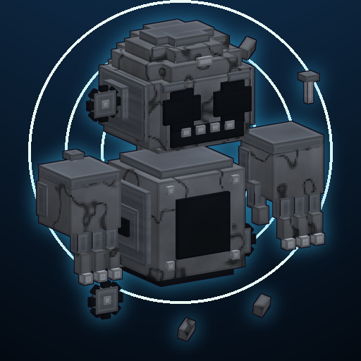

# DR-0N Mega Drone — Minecraft Bedrock

**DR-0N** é um robô de peças flutuantes para Minecraft Bedrock (celular, PC e console) com **itens infinitos**
(cabeça, tronco com núcleo de energia e duas mãos soltas que voam; dá pra **desligar** — ele desmonta
no chão — e **ligar** de novo, com as peças voando e se montando).
Ele vira **12 veículos** (helicóptero, carro, moto, caminhão-monstro, escavadeira, tanque, jato, caça
furtivo, nave espacial, disco voador, lancha e submarino), vira uma **torreta gigante**, o **robô
gigante TITÃ** (você vai em cima da cabeça, quase imortal), um **enxame de milhares de nanorrobôs**,
**explode num exército de robôs**, constrói **cidades, castelos e montanhas-russas**, tem um
**catálogo de 4851 construções mobiliadas** e **transforma biomas**.

> Criado por **0neajx**. Modelos, texturas, animações, sons e código são originais deste projeto
> (veja `LICENSES_AND_ASSETS.md`). A versão 2.0 removeu a Lila: o add-on agora é só o DR-0N.



## 1. Instalar (Android)

1. Baixe **`DR-0N_Mega_Drone.mcaddon`** (pasta `dist/` ou a página de download).
2. Toque no arquivo → abrir com **Minecraft**. Ele importa os dois pacotes.
3. Editar mundo → **Pacotes de Comportamento** → ative **DR-0N Mega Drone (BP)**. Se o mundo tinha
   a versão antiga (Lila Companion), desative ela antes.
4. Não precisa de experimentos nem de cheats. Requisito: Bedrock **1.26.30+** (testado no
   servidor oficial 1.26.65.1).

## 2. Começando

Ao entrar no mundo **nada aparece**. Fabrique o **Controle do DR-0N** (bancada):

```
F V F     F = barra de ferro   V = vidro
R D R     R = pó de redstone   D = diamante
F _ F
```

Use o controle → **Invocar DR-0N**. Pelo chat: `/drone <ordem>` (ou `/drone` sozinho = menu).

**Cancelar tudo** (primeiro botão vermelho, ou "cancela" / "volta ao normal") larga qualquer tarefa
e volta à forma normal: junta o exército, desfaz veículo, TITÃ, enxame e torreta.

**Desligar / ligar** (botão no controle, ou "desliga" / "liga"): desligado, ele desmonta no chão com os
brilhos apagados e fica quieto (não segue, não ataca). Ligando, as peças sobem girando e se montam.

**Luta:** ele alterna **socos fortes** (a mão voa no alvo e arremessa) com **tiros do núcleo** do
peito, e protege você atacando primeiro.

## 3. Veículos

"vira helicóptero / carro / moto / caminhão-monstro / escavadeira / tanque / jato / caça furtivo /
nave / disco voador / lancha / submarino" (ou menu **Veículos**). Ele se transforma do seu lado e você
já entra. **A capota recolhe quando você entra: dá pra ver tudo em volta.**

| Botão do jogo | O que faz |
|---|---|
| andar | acelera / ré |
| olhar | direção — nos voadores, olhar pra cima/baixo e acelerar sobe/desce |
| pular | o veículo **pula** (terrestres, lancha) · sobe (helicóptero, nave, disco, submarino) · pós-combustor (jatos) |
| bater | arma: metralhadora (helicóptero), canhão (tanque), mísseis (jatos), cavar (escavadeira), lasers (nave), raio desintegrador / **raio trator** olhando pra baixo (disco), torpedo (submarino), **turbo** (carro, moto, caminhão, lancha) |
| **agachar** | **sai** — e ele volta a ser drone (do alto você cai devagar) |

Velocidades: carro ~23 blocos/s, moto ~26, caminhão ~20, tanque ~11, escavadeira ~9, lancha ~25 na
água, helicóptero ~20, disco ~28, nave ~36, jato ~44, caça furtivo ~60. Submarino: quem está dentro
respira e enxerga debaixo d'água. Outros jogadores podem pegar carona tocando no veículo. **Só o dono
pilota.**

## 4. Robô gigante TITÃ

"modo colosso" (ou "robô gigante", "titã", "robozão"). Robô humanoide original de ~26 blocos (armadura
branca e vermelha, visor em T, reator no peito, propulsores nas costas). Ele te põe **em cima da
cabeça** (plataforma com corrimão baixo: visão 360°), onde você fica **quase imortal**.

- **andar**: passadas pesadas (tremor de tela, poeira), derruba árvores/paredes na frente, sobe morros;
- **bater perto**: soco que destrói blocos e arremessa inimigos · **mirar longe e bater**: raio do visor;
- **pular**: salto com os propulsores e onda de choque ao cair;
- **agachar**: sai (cai devagar);
- **painel** (use o controle lá em cima): pose de poder (monstros ficam fracos), pisão, trocar de lugar.

Mais pessoas sobem nas ombreiras e na mochila. Se você sair sem cancelar, ele **continua TITÃ**
(parado, pisando em monstros) até você mandar "Cancelar".

## 4b. Enxame de nanorrobôs

"modo enxame" (ou menu **Modo ENXAME**). O DR-0N vira milhares de robozinhos. Ele continua fazendo tudo
que o drone faz (seguir, construir, aplainar, itens infinitos...) e mais:

- **Escudo em volta de você** (ligado ao virar enxame): você não leva dano, flechas e bolas de fogo
  somem, monstros que chegam perto são empurrados e picados;
- pica sozinho os monstros perto de você (e quem estiver marcado como inimigo);
- formas: **muralha**, **ponte** (40 blocos para onde você olha), **escada**, **cúpula** (abrigo com
  porta) — blocos de nanorrobô que se desmancham sozinhos depois —, **punho gigante**, **espada
  giratória**, **tornado**, **asas** (pular alto e planar), **elevador**, **ataca** (o que você mira) e
  **devora tudo** (destrói tudo em volta, rápido);
- já em enxame, basta escrever "ponte", "escudo", "tornado"... "Cancelar" desmancha tudo.

## 5. Torreta gigante

"modo torreta": pousa, crava no chão e vira uma arma gigante (metralhadora rotativa de 6 canos,
lança-mísseis, radar). Atira em todo monstro perto e em **qualquer um que te atacar** (jogador também).

## 6. Proteção e revide

- **Me proteger**: ataca primeiro qualquer monstro a até 32 blocos de você.
- Quem bater em você ou nele vira **alvo marcado** — inclusive outros jogadores — até cair ou fugir.
- Se **você** bater nele, leva uma **lição de leve** (3 tirinhos fracos). Dá pra desligar em
  Configurações.

## 7. Modo exército

"modo exército" (ou "com 15 robôs"; padrão 10, até 24). O drone sobe, explode num clarão e vira
robôs-soldado humanoides. Eles:

- seguem você com a IA do jogo (pulam, nadam, abrem portas) e teleportam se você for longe;
- caçam monstros antes de chegarem, revidam em quem te atacar (jogador também), atiram laser;
- **trazem o que você precisa**: maçã dourada + regeneração com vida baixa, comida com fome,
  armadura de netherita encantada se você estiver sem, visão noturna no escuro, respiração na água,
  resistência ao fogo, queda lenta em queda livre, força/resistência quando há muitos monstros.

Comandos (menu **Comandar o exército**): proteger, seguir, ficar, atacar o que você olha, ir até onde
você olha, formação em círculo, me fortalecer. **Cancelar** junta todos no drone.

## 8. Itens infinitos e kit de força

- "me dá 64 diamantes", "me dá um élitro", "me dá uma espada de netherite", "me dá tnt"... ou o menu
  **Itens infinitos** (lista + campo de texto aceitando o id do jogo, ex.: `golden_apple`).
- "me fortalece": veste **netherita encantada** (Proteção IV, Inquebrável III, Remendo...) e entrega
  espada (Afiação V...), arco (Força V, Infinidade), picareta, machado, escudo, élitro, foguetes,
  totem, maçãs douradas e encantadas, pérolas, mais efeitos de força/resistência/regeneração.

## 9. Construções gigantes e biomas

"constrói um castelo aqui", "faz uma cidade inteira", "cria uma vila", "faz uma montanha russa"...
Material infinito, montado por partes sem travar o jogo, com o drone voando e disparando o feixe:

castelo (muralhas com ameias, 4 torres, portão com grade, ponte, fosso, torre de menagem) · cidade
(ruas com faixa, calçadas, postes, prédios, arranha-céus com heliponto, casas, praça e parque) · vila
(casas de várias madeiras, caminhos, poço, plantações, postes, igreja com sino) · montanha-russa
(subida com trilhos energizados, quedas, curvas, estação e carrinho) · poço · labirinto (gerado na
hora, tesouro no centro) · casa inteligente (lâmpadas que acendem sozinhas à noite, portas
automáticas, piscina iluminada, "placas solares", câmeras) · montanha (neve no pico, árvores,
cachoeira) · pirâmide · farol · arranha-céu de 30 andares · estádio. As casas antigas (cabana, casa,
torre, mansão, fazenda...) continuam no menu.

**Construção à mão (padrão):** ele voa até cada ponto e coloca bloco por bloco, parte por parte, de
baixo para cima, como um jogador construindo voando (feixe, som do material, poeira). Velocidade em
Configurações ou por texto ("constrói devagar", "constrói rápido", "constrói na hora"):
à mão ~10 blocos/s · normal ~60 · rápido ~500 · instantâneo. Ele avisa o tempo estimado — obras
gigantes à mão levam bastante (é um jogador construindo uma cidade!).

Ele **não derruba construção sua**: a limpeza do terreno só tira blocos naturais e, se houver coisa
sua no lugar, ele escolhe outro ao lado.

**Aplainar / destruir em volta:** "deixa tudo plano" (ou menu) tira o que é natural acima do chão num
raio de 12 a 64 blocos, tapa buracos e deixa plano. "destrói tudo" tira **tudo**, inclusive
construções — menos baús, camas e blocos que guardam itens. No fim ele recolhe os itens do chão.
**Recolher itens:** "recolhe os itens do chão" — ele aspira os itens em volta e guarda com ele.

**Biomas** (raio de 36 blocos): neve, deserto, selva, cerejeiras, cogumelos, flores, floresta,
pântano. *Limite do jogo:* script não troca o ID do bioma (o Bedrock não tem `/fillbiome`), então a
cor da grama e o clima continuam os de antes; chão, árvores, plantas, gelo e água mudam.

## 9b. Catálogo: 4851 construções mobiliadas

Menu **Catálogo: 1000+ construções** (escolha categoria → tipo → estilo → tamanho, ou "Surpresa") ou
por texto: "faz uma padaria pequena estilo japonês", "constrói um hospital futurista", "faz uma
igreja gótica grande", "faz uma fonte", "constrói uma torre de mago".

- **67 tipos** — casas (casa, cabana, sobrado, bangalô, mansão, prédio, hotel, castelinho, torre de
  mago, casa na árvore, iglu, palácio), comércio (padaria, açougue, ferreiro, farmácia, livraria,
  taverna, restaurante, cafeteria, mercado, banco, joalheria, roupas, barbearia, correio, ferragens,
  pet shop, floricultura, brinquedos, shopping, posto), públicos (escola, hospital, delegacia,
  bombeiros, prefeitura, igreja, biblioteca, museu, teatro, cinema, estação, academia, prisão,
  quartel, observatório, laboratório, fábrica, oficina), fazenda (celeiro, estábulo, galinheiro, silo,
  moinho, estufa, casa de fazenda, armazém, apiário) e lazer (torre de vigia, farolzinho, quiosque,
  coreto, piscina, cais, arena, parquinho);
- **21 estilos** — medieval, rústico, moderno, futurista, japonês, desértico, nórdico, tropical,
  gótico, colonial, castelo, infernal, gelo, mansão, rural, praiano, steampunk, élfico, industrial,
  colorido, savana · **3 tamanhos** · mais **30 objetos** (fonte, estátua, poste, banco de praça,
  árvore, canteiro, barraca de feira, carroça, fogueira, ponto de ônibus, jardim zen, laguinho...).
- **Interior arrumado**: quarto (cama, criados-mudos com lanterna, baú, estante), cozinha (fogão,
  forno, pia, bancada, armários em cima, mesa com bolo), sala (sofá, TV, estante, tapete), banheiro,
  escritório, loja com balcão, sino e a mercadoria certa (pão na padaria, armas no ferreiro, poções na
  farmácia...), sala de aula com carteiras e lousa, igreja com bancos, altar e velas, hospital com
  leitos, celas, baias com feno e bebedouro, estufa com plantação. Escada de mão entre andares,
  portas com as duas metades, luzes, janelas, telhado do estilo e caminho até a porta, **virada para
  você**.

## 10. Sons e animações

13 sons **originais sintetizados** (rotor, motor, turbina, canhão, metralhadora rotativa, pisão,
rugido mecânico, raio de plasma, servo, míssil, transformação, explosão do exército, laser), tocados
junto com sons do próprio Minecraft para dar peso. Animações em Molang contínuo (suaves em qualquer
FPS): rotores, rodas que giram com a velocidade e esterçam, moto que inclina nas curvas, recuo do
canhão, trem de pouso que recolhe, metralhadora que gira, transformação que monta girando, capotas
que recolhem quando alguém entra, hélice do submarino e da lancha, anel de luzes do disco voador,
TITÃ com passada de joelho, soco com giro do tronco, salto com propulsores, raio do visor e pose de
poder; enxame com anéis de nanorrobôs; robôs com andar, voo de propulsor, tiro e entrega.

## 11. Testes

- `node --test tests/unit.test.mjs` — parser de frases (inclusive as novas), receitas, caminhos.
- `node tests/validate_ids.mjs` — todo `minecraft:*` usado existe no jogo.
- `python3 tools/validate_packs.py` — referências cruzadas, formato de animações, sons, formas.
- `cd tools && npx tsc -p tsconfig.json` — tipos contra as APIs oficiais 2.8.0.
- `python3 tools/bds_test/run_bds_test.py <bedrock-server> [owner]` — servidor oficial do Bedrock,
  autoteste dentro do mundo (com `owner`, jogadores simulados "Dono" e "Intruso").

Resultados e o que **não** foi testado: `tests/CHECKLIST.md`.

## 12. Gerar de novo

```
python3 tools/build_assets.py --previews   # modelos, texturas, animações, sons, partículas, entidades
python3 tools/package_mcaddon.py           # dist/DR-0N_Mega_Drone.mcaddon + fonte
python3 tools/build_site.py                # site/index.html (página de download)
```
