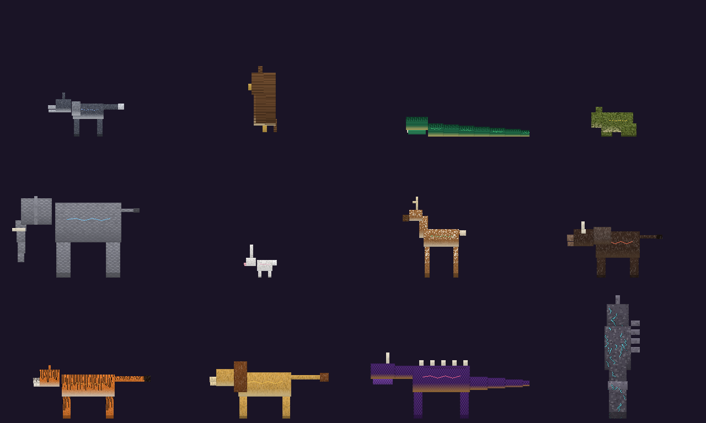

# SHADOWBOUND 🌙 — v2.0

**Esquadrão de sombras autônomas para Minecraft Bedrock (Android e Windows).**

Você invoca sombras, dá ordens em português normal e elas entendem, planejam, executam ações reais no mundo,
conferem o resultado e continuam trabalhando sozinhas. Elas obedecem **só a você**.

Com uma sombra só, ela faz tudo sozinha. Com várias, **cada uma pega uma parte do serviço** pela especialidade
dela, elas passam itens uma pra outra, correm pra ajudar quem está apanhando e conversam entre si.

## As seis companheiras

| | Quem é | Especialidade |
|---|---|---|
| **Luna** | Bruxinha fofa, chapéu e vassoura; raio mágico à distância | magia, fabricação e cozinha |
| **Raven** | Guerreira das sombras, cabelo prateado e cachecol vermelho | combate e caça |
| **Sora** | Psíquica orgulhosa de cabelo verde cacheado e vestido preto longo; flutua | mineração e demolição |
| **Yuki** | Elegante "irmã mais velha", cabelo escuro, vestido verde e estola branca | cozinha, entregas e proteção |
| **Hana** | Fazendeira de chapéu de palha, macacão verde e cesta de frutas | comida, plantação e madeira |
| **Aiko** | Construtora animada, cabelo laranja, óculos de proteção e martelo | obras grandes e madeira |


### Visual semi-realista (v2.0)
Dentro do que o Bedrock permite (modelos de cubos com textura), as seis foram redesenhadas com cara mais natural:
- textura **8× mais detalhada** (1024 px) com **luz pintada**: luz de cima, sombra embaixo, oclusão nas bordas e dobras de tecido;
- **olhos amendoados** com íris em camadas, sombra da pálpebra, dois reflexos, cílios afinados e prega da pálpebra;
- **sobrancelhas da cor do cabelo**, bochechas suaves, lábios, **nariz 3D** de verdade (um cubinho com luz e sombra);
- **cabelo em duas camadas** de mechas finas com brilho, para dar profundidade.

Cada personagem manteve cores, roupa, acessórios e personalidade. Visual não sexualizado.

Expressões (normal, piscando, feliz `^ ^` com blush, focada em combate), piscar automático e boca que mexe quando ela fala:


## As criaturas das sombras
Doze criaturas originais que você invoca e desinvoca quando quiser. Elas lutam, caçam e protegem com habilidades
próprias, mas **não coletam, não fabricam e não constroem**. Cada uma tem **cores e textura próprias** (pelo, penas,
escamas, pele ou pedra), olhos que brilham, boca que abre e **animações só dela**: o lobo uiva e abana o rabo, a coruja
gira a cabeça e mergulha, a serpente desliza e dá o bote, o sapo pula e estica a língua, o elefante abana as orelhas e
ergue a tromba, o coelho pula e bate a pata, o cervo pasta, o touro cava o chão, o tigre anda agachado e dá o bote,
o leão chacoalha a juba e ruge, o dragão bate as asas e cospe fogo, o colosso pisa pesado e esmaga com os dois punhos.

Lobo (rápido, caça em dupla) · Coruja (mergulho que deixa lento) · Serpente (prende e envenena) · Sapo (puxa com a língua) ·
Elefante (jato d'água que empurra e apaga fogo) · Coelho (nuvem que cega) · Cervo (cura você e o esquadrão) ·
Touro (investida) · Tigre (golpes fortes) · Leão (rugido que enfraquece) · Dragão (sopro de fogo em área) ·
Colosso (fica mais resistente a cada golpe que recebe).



## ⬇️ Instalar
Site de download: `site/index.html` (botão "Baixar mod" que baixa direto).
Arquivo: **[`dist/Shadowbound.mcaddon`](dist/Shadowbound.mcaddon)**. Passo a passo para celular e PC: **[INSTALAR.md](INSTALAR.md)**.
Requer Minecraft Bedrock **1.26.40+** (Play Store atual: 1.26.60). Sem experimentos, sem cheats.

## O que elas fazem (de verdade)
- **Esquadrão**: até 12 sombras por padrão (dá pra subir até 40 no menu). Fale com todas (`me sigam`) ou com uma só pelo nome (`raven, me proteja`, `lobos, ataquem`).
- **Divisão de trabalho**: `pegue 64 troncos` com três sombras → cada uma pega uma parte, e o total é **exatamente** o que você pediu.
- **Seguem e protegem**: defendem você de monstros, não perseguem para longe, não atacam animais sem ordem. Quando você está seguro, **voltam para a tarefa** de onde pararam.
- **Coletam madeira**: acham árvores naturais (nunca a sua casa de tronco), cortam, recolhem, voltam e entregam. Se não tem árvore perto, **saem explorando**.
- **Conseguem comida de forma inteligente**: colhem e replantam; sem plantação, **caçam animais e assam a carne** numa fornalha; procuram mais longe se precisar.
- **Mineram**: pedra, carvão, ferro, ouro, diamante, areia... Fabricam a picareta necessária e cavam uma escada segura (param em lava ou água).
- **Fabricam e fundem**: tábuas, gravetos, bancada, tochas, baú, fornalha, cerca, porta, pão, ferramentas; usam fornalha de verdade (e colocam uma se precisar).
- **Constroem grande**: casinha, **casa grande** (9×7) e **mansão** (13×11, dois andares, sacada e escada) com chão, pilares, janelas, porta, telhado, tochas, mesa e baú. Calculam o material, **vão buscar o que falta** antes de começar, limpam o terreno e conferem o resultado.
- **Quebram** o bloco que você está olhando, ou cavam um buraco (só blocos naturais).
- **Inventário próprio** (27 espaços), equipamento, durabilidade, entrega de itens para você e entre elas.
- **Fome simulada**: comem sozinhas quando precisam, guardam reserva, nunca comem item raro.
- **Morrem e voltam** sem duplicar item nem corpo, retomando a tarefa.
- **Memória persistente**: esquadrão, tarefas, progresso, inventário, fome e configurações ficam salvos no mundo.
- **Falam com você** em PT-BR, só com você, cada uma com seu jeito, contando o estado real (nunca dizem que terminaram antes de conferir).

## Arquitetura
Módulos independentes em [`scripts/`](scripts) (TypeScript): autorização, percepção, linguagem natural, planejador,
esquadrão, executor, memória, inventário, sobrevivência, navegação (A*), combate e criaturas, recuperação,
comunicação, UI e IA opcional. Detalhes e interfaces: **[documentation/ARQUITETURA.md](documentation/ARQUITETURA.md)**.

## Qualidade e testes
- Typecheck estrito contra as typings oficiais `@minecraft/server` 2.3.0 / `@minecraft/server-ui` 2.1.0 (as versões declaradas no manifest).
- Validador cruzado dos dois pacotes (18 geometrias, 129 animações, texturas, propriedades, eventos, partículas, idioma; confere que cada animação de criatura só mexe em ossos que existem no modelo dela).
- **48 testes automáticos**, incluindo testes de integração que rodam o cérebro real num simulador da API.
- O que **ainda falta testar dentro do jogo**: [documentation/TESTES.md](documentation/TESTES.md).
- Limitações reais da plataforma: [documentation/LIMITACOES.md](documentation/LIMITACOES.md).

```bash
npm install
npm run all        # typecheck + testes + build (gera dist/*.mcaddon)
npm run art        # regenera modelos, texturas e animações (Python + Pillow)
```

## IA generativa (opcional)
Funciona **100% offline** com o interpretador local. Em servidor BDS dá pra ligar uma IA externa: [optional/README.md](optional/README.md).

## Licença
MIT
