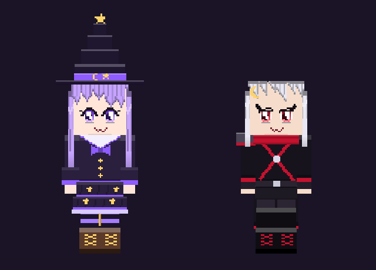

# SHADOWBOUND 🌙

**Companheiras de sombra autônomas para Minecraft Bedrock (Android e Windows).**

Você invoca uma sombra, dá ordens em português normal e ela entende, planeja, executa ações reais no mundo,
confere o resultado e continua trabalhando sozinha. Ela obedece **só a você**.

| Luna, a bruxinha | Raven, a guerreira das sombras |
|---|---|
| Fofa e esperta, chapéu de bruxa, vassoura nas costas, ataca à distância com raio mágico. | Fria e confiante, rabo de cavalo prateado, cachecol vermelho, adagas, forte no corpo a corpo. |



Expressões (normal, feliz `^ ^` com blush, focada em combate), piscar automático e boca que mexe quando ela fala:


## ⬇️ Instalar
Arquivo: **[`dist/Shadowbound.mcaddon`](dist/Shadowbound.mcaddon)**. Passo a passo para celular e PC: **[INSTALAR.md](INSTALAR.md)**.
Requer Minecraft Bedrock **1.26.40+** (Play Store atual: 1.26.60). Sem experimentos, sem cheats.

## O que ela faz (de verdade)
- **Segue e protege**: defende você de monstros, não persegue para longe, não ataca animais sem ordem. A Luna lança raios mágicos (inclusive em creeper, de longe).
- **Coleta madeira**: acha árvores naturais (nunca a sua casa de tronco), anda até lá, corta com o tempo e a ferramenta certos, recolhe os itens, volta e entrega.
- **Consegue comida**: colhe plantações maduras e replanta, pega frutinhas, faz pão na bancada; caça só com a sua permissão.
- **Minera**: pedra, carvão, ferro, ouro, diamante, areia... Fabrica a picareta necessária e, se não houver nada exposto, cava uma escada segura (para em lava ou água).
- **Fabrica**: tábuas, gravetos, bancada (e coloca no chão), tochas, baú, fornalha, pão, escadas e ferramentas de madeira até diamante.
- **Cozinha e funde numa fornalha de verdade**: coloca os itens e o combustível, espera e recolhe. Não mexe em fornalha que já tenha coisas suas.
- **Constrói** a partir de plantas: casinha, muro, plataforma, ponte, pilar e torre com escada. Confere material e espaço antes de começar.
- **Quebra** o bloco que você está olhando, ou cava um buraco (só blocos naturais, nada de destruir suas construções).
- **Inventário próprio** (27 espaços), equipamento (ferramenta, armas, armadura, escudo), durabilidade, entrega de itens.
- **Fome simulada**: come sozinha quando precisa (pão, por exemplo), guarda reserva, nunca come item raro.
- **Morre e volta** sem duplicar item nem corpo, retomando a tarefa.
- **Memória persistente**: dono, tarefa, progresso, inventário, fome e configurações ficam salvos no mundo.
- **Fala com você** em PT-BR, só com você, contando o estado real (nunca diz que terminou antes de conferir).

## Arquitetura
Módulos independentes em [`scripts/`](scripts) (TypeScript): autorização, percepção, linguagem natural, planejador,
executor, memória, inventário, sobrevivência, navegação (A*), combate, recuperação, comunicação, UI e IA opcional.
Detalhes e interfaces: **[documentation/ARQUITETURA.md](documentation/ARQUITETURA.md)**.

## Qualidade e testes
- Typecheck estrito contra as typings oficiais `@minecraft/server` 2.3.0 / `@minecraft/server-ui` 2.1.0 (as versões declaradas no manifest).
- Validador cruzado dos dois pacotes (geometria, texturas, animações, propriedades, eventos, partículas, idioma).
- **41 testes automáticos**, incluindo testes de integração que rodam o cérebro real num simulador da API.
- O que **ainda falta testar dentro do jogo**: [documentation/TESTES.md](documentation/TESTES.md).
- Limitações reais da plataforma: [documentation/LIMITACOES.md](documentation/LIMITACOES.md).

```bash
npm install
npm run all        # typecheck + testes + build (gera dist/*.mcaddon)
npm run art        # regenera modelos, texturas e animações (Python + Pillow)
```

## IA generativa (opcional)
Funciona **100% offline** com o interpretador local. Em servidor BDS dá pra ligar uma IA externa: [optional/README.md](optional/README.md).

## Licença
MIT
