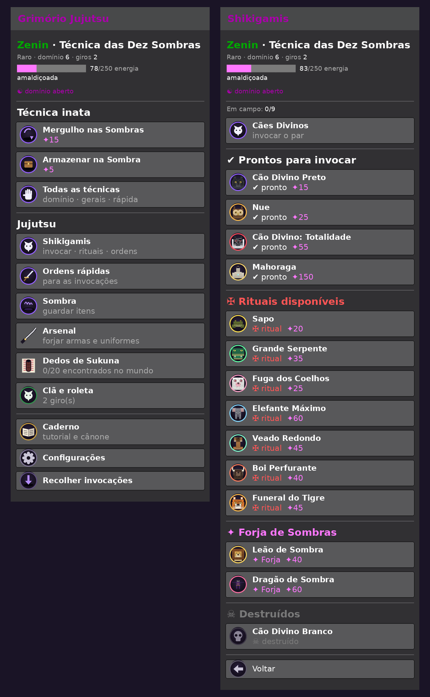

# Jujutsu Kaisen: Legado 🌑 — v4.0

**Mod de fã para Minecraft Bedrock (Android e Windows) inspirado em Jujutsu Kaisen.**
Na primeira vez que você entra, a **roleta de clã** gira e sorteia seu clã e sua técnica inata. Você domina
essa técnica com efeitos de energia amaldiçoada, abre a Expansão de Domínio, forja ferramentas amaldiçoadas,
veste o uniforme da escola e caça os 20 Dedos de Sukuna. Tudo pelo **Grimório Jujutsu**, com menus por toque.

> Mod pessoal, sem ligação oficial com Jujutsu Kaisen (Gege Akutami / Shueisha). Modelos, texturas, ícones e
> textos são originais. O que é cânone, interpretação ou criação do mod está em
> **[documentation/PESQUISA_JJK.md](documentation/PESQUISA_JJK.md)** (com fontes) e no Caderno dentro do jogo.

## Roleta de clã
| Clã | Raridade | Técnicas possíveis |
|---|---|---|
| **Gojo** | Lendário · 3% | Ilimitado + Seis Olhos |
| **Zenin** | Raro · 22% | Dez Sombras · Feitiçaria de Projeção · Restrição Celestial |
| **Kamo** | Incomum · 18% | Manipulação de Sangue |
| **Inumaki** | Incomum · 12% | Fala Amaldiçoada |
| **Sem clã** | Comum · 45% | Boneco de Palha · Boogie Woogie · Proporção · Construção |

Você começa com 2 giros extras e ganha +1 a cada nível de domínio (Grimório → Clã e roleta).

## Técnicas e habilidades
| Técnica | Habilidades | Domínio |
|---|---|---|
| Ilimitado + Seis Olhos | Infinito (alternável), Azul, Vermelho Reverso, Roxo Oco; custos pela metade | Vazio Infinito |
| Dez Sombras | 14 shikigamis com rituais e herança, Mergulho nas Sombras, Armazenar na Sombra | Jardim Sombrio da Quimera |
| Feitiçaria de Projeção | Investida de 24 Quadros, Aceleração, Quadro Congelado | — |
| Restrição Celestial | Corpo sobre-humano sempre ativo, Vigor no lugar de energia, Investida e Salto Celestial; +50% com ferramentas | — |
| Manipulação de Sangue | Sangue Perfurante, Amarração Carmesim, Supernova, Escamas Vermelhas Fluentes (custam vida) | — |
| Fala Amaldiçoada | "Não se mexa", "Exploda", "Durma", "Esmague" (cada ordem força a garganta) | — |
| Boneco de Palha | Pregos (marcam), Ressonância, Grampo | — |
| Boogie Woogie | Palma (troca de lugar), Troca Confusa | — |
| Proporção | Golpe 7:3, Hora Extra, Colapso | — |
| Construção | Criar Munição, Lâmina e Escudo | — |
| Santuário (receptáculo de Sukuna) | Desmantelar, Clivar (3 dedos), Fuga (10 dedos) | Santuário Malevolente (15 dedos) |

Todo feiticeiro (menos a Restrição Celestial) também tem: **Reforço com Energia**, **Black Flash** (chance ao
acertar), **Domínio Simples** e **Técnica Reversa**. Cada habilidade tem partículas da cor da técnica: esferas,
raios, anéis, auras e explosões. Nenhuma habilidade destrói blocos.

## Dedos de Sukuna
São 20 por mundo e caem raramente de inimigos. Comer um é arriscado: 25% de chance de virar **receptáculo** (libera
o Santuário); senão o veneno quase te mata. A influência de Sukuna cresce a cada dedo e, com ela alta, ele pode
**assumir o seu corpo** por alguns segundos. Meditar empurra ele de volta.

## Arsenal
Forje direto no Grimório, sem bancada, usando Fragmentos Amaldiçoados (caem de inimigos):
- **Ferramentas:** Nuvem Brincalhona, Lança Invertida do Céu (fura a adaptação do Mahoraga), Katana Alma Dividida, Osso de Dragão e Demônio Matador.
- **Uniformes:** jaqueta e calça da Escola de Tóquio, jaqueta da Escola de Kyoto e a Venda Preta, que aparecem no seu personagem.
- **Consumível:** Xarope para Garganta.

## Interface
O **Grimório Jujutsu** abre com o clã e a técnica no topo, a barra de energia e as habilidades com **ícone** para
usar com um toque. Ele tem seções para Técnicas, Shikigamis (Dez Sombras), Arsenal, Dedos de Sukuna, Clã e roleta,
Caderno e Configurações. **Agachar e usar o Grimório** solta a sua habilidade rápida. Os comandos `/sombra` são opcionais.



## ⬇️ Instalar
Site de download: `site/index.html` (botão "Baixar mod"). Arquivo: **[`dist/Shadowbound.mcaddon`](dist/Shadowbound.mcaddon)**.
Passo a passo para celular e PC: **[INSTALAR.md](INSTALAR.md)**. Requer Minecraft Bedrock **1.26.40+**, sem experimentos.

## Qualidade e testes
- Typecheck estrito contra `@minecraft/server` 2.3.0 / `@minecraft/server-ui` 2.1.0 (as versões do manifest).
- Validador cruzado dos pacotes: geometrias, animações, itens (ícone, nome e attachable), partículas e propriedades.
- **44 testes automáticos**: roleta, técnicas de vários clãs, dedos, arsenal, Dez Sombras (rituais, herança, Mahoraga) e interface.
- O que ainda falta testar dentro do jogo: [documentation/TESTES.md](documentation/TESTES.md).

```bash
npm install
npm run all        # typecheck + testes + build (gera dist/*.mcaddon e o site)
npm run art        # regenera modelos, texturas, ícones, itens e animações (Python + Pillow)
```

## Licença
MIT (código). Jujutsu Kaisen e seus personagens pertencem aos seus donos.
